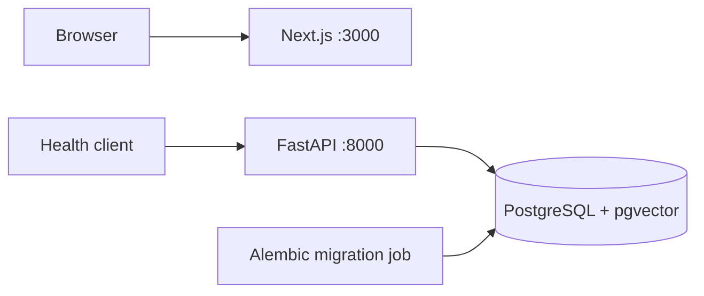

# Architecture

The repository is a small polyglot monorepo. Each application owns its manifest, lockfile, Dockerfile, and tooling; Compose coordinates them without an extra build orchestrator.

## Boundaries

- **API:** FastAPI wires routes and application lifetime. Configuration validates environment variables once. The database module owns the engine, declarative base, and request-scoped sessions. Synchronous database work runs in synchronous handlers.
- **Web:** Next.js App Router renders a static placeholder using TypeScript and Tailwind. It does not call the API yet.
- **Database:** PostgreSQL stores persistent data; pgvector is enabled for future work. No vector models, embeddings, retrieval, or application tables exist.
- **Migrations:** Alembic imports the same configuration and metadata as the API. The one-shot migration service must succeed before the API starts.

## Runtime

`GET /health` checks database availability with `SELECT 1`, returning 200 with `{"status":"ok"}` or 503 with `{"status":"unavailable"}`. It is a readiness check, not a business API. Compose readiness controls startup; later database failures mark the API unhealthy without an automatic restart policy.

The database volume mounts at `/var/lib/postgresql`, matching PostgreSQL 18's layout. API and migration services share an image and database environment. Passwords are passed as fields to SQLAlchemy's URL builder, avoiding URL-escaping errors.

Production images run applications as non-root users and contain no development tools. Development targets add tools and mount source, keeping dependencies and generated output in containers. Database creation uses the official image's local bootstrap role; deployment role separation is deferred.

See [ADR 0001](adr/0001-monorepo-foundation.md) for decisions and [README](../README.md) for commands.
