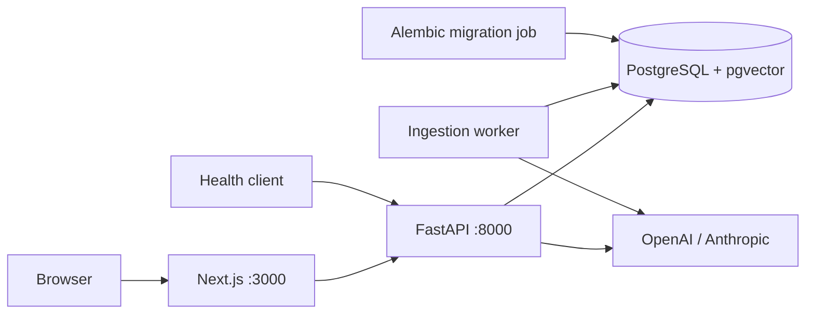

# Architecture

The repository is a small polyglot monorepo. Each application owns its manifest, lockfile, Dockerfile, and tooling; Compose coordinates them without an extra build orchestrator.

## Boundaries

- **API:** FastAPI wires routes and application lifetime. Configuration validates environment variables once. The database module owns the engine, declarative base, and request-scoped sessions. Synchronous database work runs in synchronous handlers.
- **Web:** Next.js App Router renders the public career conversation and protected admin pages. The public client uses a fixed-destination `/api/chat` streaming proxy. Admin server components check the session before rendering; client forms use a separate same-origin `/api/admin/*` proxy.
- **Database:** PostgreSQL stores the administrator, session token hashes, encrypted provider keys, RAG configuration, career records, skill associations, and resume PDF bytes. Ingestion jobs, logs, extracted text, and chunks are durable; pgvector stores embeddings.
- **Migrations:** Alembic imports the same configuration and metadata as the API. The one-shot migration service must succeed before the API starts.

## Runtime

`GET /health` checks database availability with `SELECT 1`, returning 200 with `{"status":"ok"}` or 503 with `{"status":"unavailable"}`. It is a readiness check, not a business API. Compose readiness controls startup; later database failures mark the API unhealthy without an automatic restart policy.

The database volume mounts at `/var/lib/postgresql`, matching PostgreSQL 18's layout. API and migration services share an image and database environment. Passwords are passed as fields to SQLAlchemy's URL builder, avoiding URL-escaping errors.

Production images run applications as non-root users and contain no development tools. Development targets add tools and mount source, keeping dependencies and generated output in containers. Database creation uses the official image's local bootstrap role; deployment role separation is deferred.

See [ADR 0001](adr/0001-monorepo-foundation.md) for decisions and [README](../README.md) for commands.

Admin endpoints enforce database-backed cookie sessions independently of the web layer. Mutations require the configured `APP_ORIGIN`. Sessions last 12 hours and are revoked on credential changes. Provider calls run in explicit connection tests, the ingestion worker, and public chat; keys are encrypted with Fernet using a separate environment secret. Migration/bootstrap runs before API startup and never replaces an existing account or configuration. See [ADR 0002](adr/0002-admin-and-rag-settings.md).

Career content uses authenticated `/admin/jobs`, `/admin/projects`, `/admin/skills`, and `/admin/documents` CRUD endpoints. Document create/update accepts multipart forms; downloads use `/admin/documents/{id}/file`. The proxy preserves binary bodies and download headers. See [ADR 0003](adr/0003-career-content.md).

The dedicated worker claims PostgreSQL jobs with row locks and leases, processes source revisions, and publishes complete vector sets atomically. See [ADR 0004](adr/0004-rag-ingestion.md).

Jobs and projects each serialize to one document before token chunking; project documents contain skill keywords. Skills are not standalone ingestion sources. Admin overview totals count current items rather than historical runs, using the same status rules as row indicators. See [ADR 0005](adr/0005-project-skill-ingestion.md).

Public chat reads saved configuration and retrieves compatible active generations using exact cosine search, optionally fused with PostgreSQL full-text ranks. Candidates and neighboring chunks are materialized in a consistent database snapshot before optional LLM reranking. Database transactions are released before provider calls. Expanded context is deduplicated and bounded; answers stream through a provider-independent SSE contract. See [ADR 0006](adr/0006-public-career-chat.md).

The public and admin interfaces share an asterisk brand mark and semantic color tokens. A small script in the root document selects the theme before paint, using the browser's saved `career-theme` preference or its system color scheme. Theme controls update the root attribute without remounting page content; media and storage events keep device changes and other tabs in sync. The preference stays in local storage and is never sent to the API.
